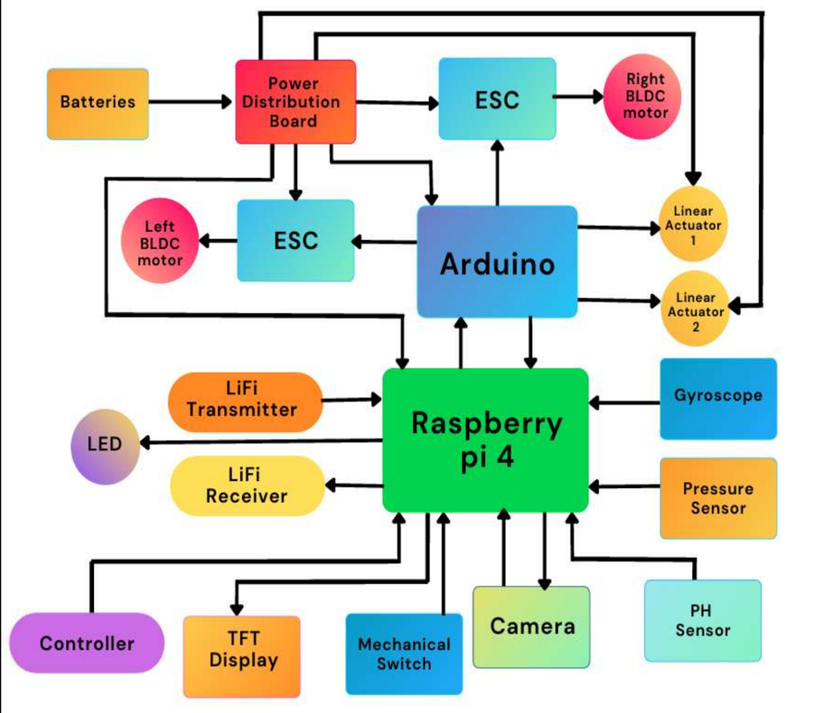
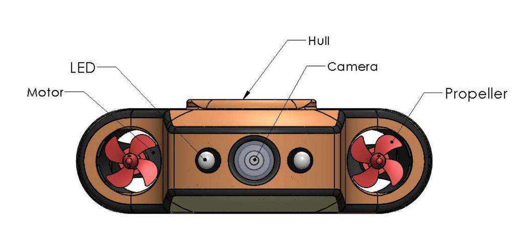
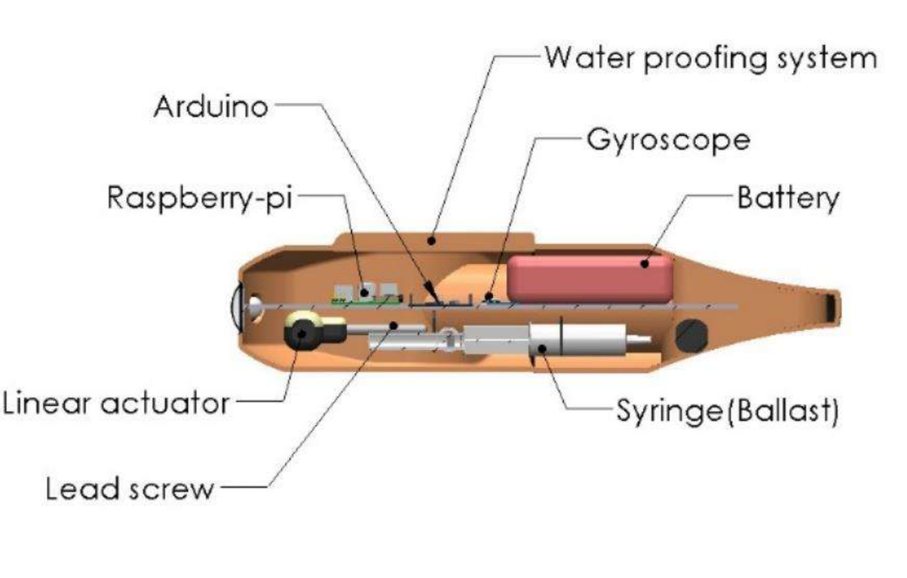

# AquaShell: Underwater Robot (UWR) Design Study

A submarine-style underwater robot designed for both remote-controlled and autonomous operation. The **hull (shell) is an original design**. The electronics and actuators in the assembly are open-source CAD models from GrabCAD, placed to check fit and layout.


> **Status:** an exploratory mechanical and system-design study, not under active development. It is kept as a reference for hull design, component packaging and buoyancy-control concepts. The full write-up is in [`docs/aquashell-project-report.pdf`](docs/aquashell-project-report.pdf).

---

## Specifications

| Item | Value |
|---|---|
| Dimensions | 500 mm (L) × 350 mm (W) × 104 mm (H) |
| Hull material | ABS, 3D-printed |
| Compute | Raspberry Pi 4 and Arduino UNO |
| Power | 12 V, 10,000 mAh (two batteries in parallel) |
| Propulsion | two brushless (BLDC) thrusters with 30 A Electronic Speed Controllers (ESCs) |
| Buoyancy | linear actuators driving 100 ml syringes as ballast |
| Sensing | pressure (depth), temperature, pH, Inertial Measurement Unit (IMU, MPU-9255), OV5647 camera |
| Underwater link | Light Fidelity (LiFi) Nano-V2 module |
| Software | Robot Operating System (ROS), multi-node |

### System block diagram

The Raspberry Pi 4 handles sensing, the camera and the LiFi link. It commands the Arduino, which drives the two thruster ESCs and the two ballast actuators.



## How it moves

| Motion | Method |
|---|---|
| Forward / backward | thruster rotation direction |
| Turning | differential thruster speeds |
| Diving / surfacing | linear actuators draw water into or push it out of the syringe ballast |
| Stability | IMU for orientation, pressure sensor for depth hold |



Inside the hull, the linear actuator turns a lead screw that draws water into, or pushes it out of, the syringe ballast to dive or surface:




## Design process

1. Concept design and 3D modelling of the hull (SolidWorks)
2. Electronic circuit design (EasyEDA)
3. Component selection and procurement
4. Circuit assembly and programming
5. Mechanical assembly and optimisation
6. Logic testing and integration

---

## Repository layout

```
aquashell/
├── submarine assembly/           # SolidWorks assembly and parts
│   ├── total body assembly.SLDASM    # top-level assembly
│   ├── total body.SLDPRT             # the original hull
│   ├── ballast_assembly.SLDASM       # syringe + actuator ballast
│   ├── base, battery, lens, lights, Thruster Motor, Actuator, Syringe_100ml …
│   ├── Raspberry Pi 4 Model B.SLDASM, MPU-9255.SLDASM, HGLRC 30A Brushless ESC.SLDASM,
│   │   UNO R4 WiFi.step          # GrabCAD component models
│   └── total isometric.PNG       # drawing sheet with the four views
├── old try/                      # earlier hull and thruster-housing attempts
├── images/                       # figures for this README (from the project report)
└── docs/
    └── aquashell-project-report.pdf
```

Open `submarine assembly/total body assembly.SLDASM` in SolidWorks to load the full robot. The folder and file names are left unchanged, because the assemblies find their parts by path.

## Possible applications

Marine research and data collection, underwater inspection and maintenance, environmental monitoring (water quality, pollution), archaeology (site survey), mine inspection, and locating fish shoals.

## Credits

- Hull design: **Adithya Pothula**
- Electronics and actuator models: third-party models from [GrabCAD](https://grabcad.com/library), which remain under their authors' terms
